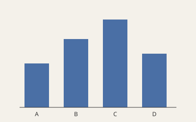

## Introduction

Literate programming mixes code and prose [@knuth1984]. @cohen1994 criticised significance testing, and others argued for looking at the data first [@tukey1977; @tufte2001, p. 13].

::: column-margin
A margin note. On phones it sits below the paragraph it belongs to.
:::

Footnotes go at the end of the page.^[A footnote.] An aside can be written inline. [An aside, written inline in the paragraph.]{.aside}

## Methods

We model the outcome as a straight line plus noise, @eq-model:

$$
y_i = \beta_0 + \beta_1 x_i + \varepsilon_i, \quad \varepsilon_i \sim \mathcal{N}(0, \sigma^2)
$$ {#eq-model}

@thm-means bounds the mean.

::: {#thm-means}
## Arithmetic and geometric means

For non-negative numbers $a$ and $b$, $\frac{a + b}{2} \geq \sqrt{ab}$.
:::

::: proof
$(\sqrt{a} - \sqrt{b})^2 \geq 0$. Expand and rearrange.
:::

## Results

@fig-counts has its caption in the margin, because the article sets `cap-location: margin`. @tbl-groups summarises it.

{#fig-counts}

| Group | Count | Share |
|:------|------:|------:|
| A     |    90 |  0.18 |
| B     |   140 |  0.28 |
| C     |   180 |  0.36 |
| D     |    90 |  0.18 |

: Counts in each group. {#tbl-groups}

::: column-page

:::

::: column-screen

:::

## Discussion

Smaller pages load faster, most of all on phones.^[A second footnote.]

::: {#nte-limits .callout-note title="Limitations"}
A callout that can be cross-referenced, as @nte-limits.
:::

## References

::: {#refs}
:::
