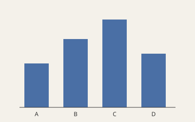
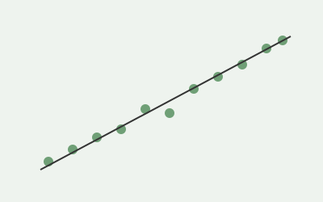



## Features

Here we demonstrate / test some basic AI-generated content, with Quarto's default options. The [article](article.qmd) shows scholarly front matter, citations and the margin.

### Text

This paragraph has **bold**, *italic*, ~~struck out~~, [small caps]{.smallcaps}, H~2~O, E = mc^2^, `inline code`, a [link to another page](article.qmd), an [external link](https://quarto.org/) and a [link to a heading](#sec-lists). Keyboard keys: .

Long words and URLs wrap instead of widening the page: Donaudampfschifffahrtsgesellschaftskapitänswitwe, <https://example.org/a/very/long/url/that/goes/on/and/on/without/any/natural/place/to/break/it>.

#### Lists {#sec-lists}

- First item
- Second item, which is long enough to wrap onto a second line on most screens, so we can see how the text aligns
  - A nested item
- Third item

1. First
2. Second
3. Third

- [x] A task that is done
- [ ] A task that isn't

Term
: The definition of the term.

#### Quotes and other blocks

> Simplicity is prerequisite for reliability.
>
> --- Edsger W. Dijkstra

| The limerick packs laughs anatomical
| Into space that is quite economical.

---

##### A fifth-level heading

###### A sixth-level heading

### Code

``` r
# Simulate and summarise
set.seed(1)
x <- rnorm(100, mean = 10, sd = 2)
fit <- lm(mpg ~ wt + hp, data = mtcars)
if (mean(x) > 9) message("Large") else stop("Small")
```

``` python
def summarise(values: list[float]) -> dict:
    """Return the mean and standard deviation."""
    return {"mean": statistics.mean(values), "sd": statistics.stdev(values)}
```

A long line scrolls inside its block:

``` r
very_long_function_name(argument_one = "a value", argument_two = "another value", argument_three = c(1, 2, 3, 4, 5, 6, 7, 8, 9, 10))
```

``` {.r filename="analysis.R"}
library(ggplot2)
ggplot(mtcars, aes(wt, mpg)) + geom_point()
```

``` r
mtcars |>
  group_by(cyl) |> # <1>
  summarise(mpg = mean(mpg)) # <2>
```
1. Group by the number of cylinders.
2. Average fuel economy in each group.

#### Cell output

These blocks copy the markup Quarto writes for executed code cells, so the demo needs no R or Python. The page sets `code-fold: show`.

::: {.cell}

``` {.r .cell-code}
x <- c(4, 8, 15, 16, 23, 42)
summary(x)
```

::: {.cell-output .cell-output-stdout}

```
   Min. 1st Qu.  Median    Mean 3rd Qu.    Max.
   4.00    9.75   15.50   18.00   21.25   42.00
```

:::
:::

::: {.cell}

``` {.r .cell-code}
warning("This is a warning")
```

::: {.cell-output .cell-output-stderr}

```
Warning: This is a warning
```

:::
:::

### Math

Inline math sits in the line: the sample mean $\bar{x} = \frac{1}{n}\sum_{i=1}^{n} x_i$ estimates $\mu$. A numbered equation, referenced as @eq-normal:

$$
f(x) = \frac{1}{\sigma\sqrt{2\pi}} \exp\left(-\frac{(x - \mu)^2}{2\sigma^2}\right)
$$ {#eq-normal}

$$
\begin{aligned}
(a + b)^2 &= (a + b)(a + b) \\
          &= a^2 + 2ab + b^2
\end{aligned}
$$

A long equation scrolls instead of widening the page:

$$
\log p(\mathbf{y} \mid \boldsymbol{\theta}) = \sum_{i=1}^{n} \left[ y_i \log \operatorname{logit}^{-1}(\eta_i) + (1 - y_i) \log\left(1 - \operatorname{logit}^{-1}(\eta_i)\right) \right] + \sum_{j=1}^{J} \log \mathcal{N}(\theta_j \mid 0, \tau^2) \ \text{This is a long one indeed.}
$$

### Figures and tables

{#fig-bars fig-alt="A bar chart with four bars labelled A to D."}

::: {#fig-panels layout-ncol=2}

{#fig-panel-a}

{#fig-panel-b}

Two panels side by side. @fig-panel-b shows a positive relationship.
:::

| Car            |   MPG | Cylinders | Horsepower |
|:---------------|------:|:---------:|-----------:|
| Mazda RX4      |  21.0 |     6     |        110 |
| Datsun 710     |  22.8 |     4     |         93 |
| Valiant        |  18.1 |     6     |        105 |

: Fuel economy of three cars, referenced as @tbl-cars. {#tbl-cars}

A wide table scrolls:

| Model | Intercept | Slope | SE | t | p | R² | Adj. R² | AIC | BIC | N | Notes |
|---|---|---|---|---|---|---|---|---|---|---|---|
| Linear | 37.23 | −5.34 | 0.56 | −9.56 | < .001 | 0.75 | 0.74 | 166.0 | 170.4 | 32 | Weight only |
| Quadratic | 49.93 | −13.38 | 2.61 | −5.13 | < .001 | 0.82 | 0.81 | 158.0 | 163.9 | 32 | Adds weight² |

### Callouts

smol shows every callout as a quote with its title in bold, whatever its type. Collapsed callouts show open.

::: callout-note
A note without a title.
:::

::: {.callout-tip title="A tip with a title"}
Tips suggest a better way to do something.
:::

::: callout-warning
## A warning with a heading as its title

Warnings point out something that could go wrong.
:::

::: {.callout-note collapse="true" title="A collapsed callout"}
It sets `collapse="true"`, but smol shows it open.
:::

### Columns and tabsets

::: {layout-ncol=2}
The first column. It has some text that is long enough to wrap onto several lines.

The second column. It also has some text that wraps onto several lines.
:::

:::: columns
::: {.column width="40%"}
Pandoc's own columns: a narrow one, 40% wide.
:::

::: {.column width="60%"}
And a wide one, 60% wide.
:::
::::

::::: grid
:::: g-col-4
Quarto's CSS grid: a third of the width.
::::

:::: g-col-8
And two thirds. Pages use these `g-col-*` classes for side-by-side lists, such as jobs and degrees on a CV page.
::::
:::::

smol doesn't support tabsets, so their tabs show one after another:

::: panel-tabset
## R

``` r
mean(x)
```

## Python

``` python
statistics.mean(x)
```
:::

### Diagrams

Drawn when rendering, so the page loads no Mermaid JavaScript.

```{mermaid}
flowchart LR
  A[Write] --> B[Render]
  B --> C{Looks right?}
  C -- Yes --> D[Publish]
  C -- No --> A
```

### Footnotes

On this page, footnotes go at the end, Quarto's default.^[This is a footnote.]

## Size


